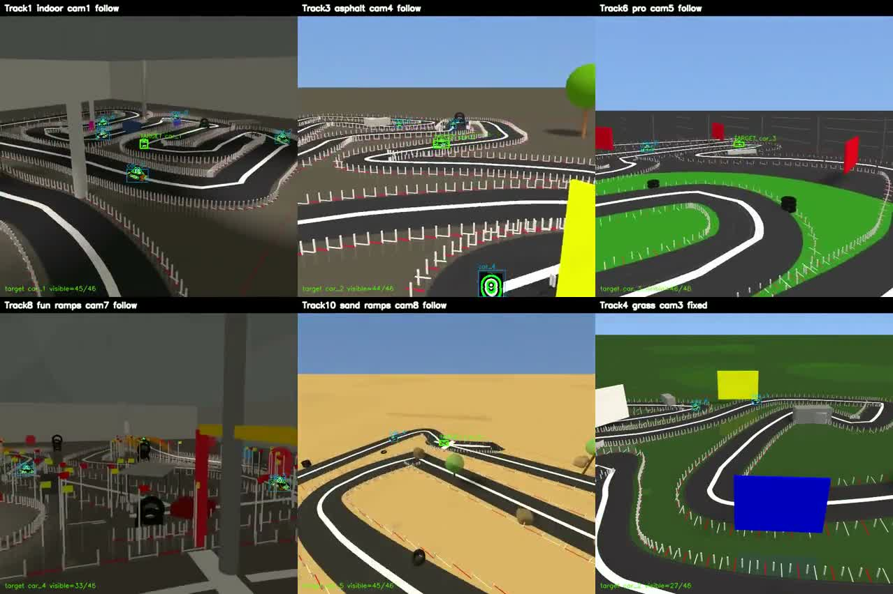
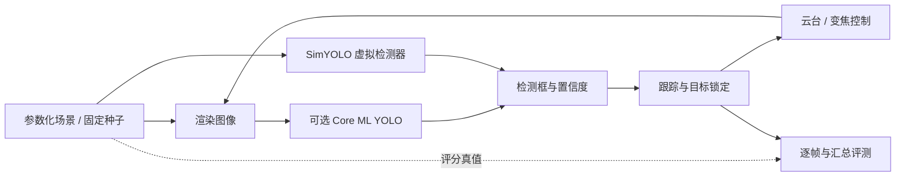

# Mac RC Simulation

用于遥控赛车自动跟拍研发的 **自建三维视觉仿真与系统评测平台**。在可控赛道、场景和机位中，评估“检测退化 → 目标跟踪 → 云台与变焦控制”的完整链路，在固定条件下比较方案。



[横屏演示视频](docs/demo/vsim-multiscene-landscape.mp4) · [历史实验与边界](docs/EXPERIMENTS.md) · [依赖与来源说明](THIRD_PARTY_NOTICES.md)

## 先看哪些代码

| 关注点 | 入口 | 展示的工作 |
|---|---|---|
| 自建多场景 | `VirtualRaceTrackGenerator.swift`、`VirtualRaceSimulator.swift` | 参数化赛道、场景、车辆、相机和遮挡；可固定随机种子 |
| 检测误差建模 | `VirtualRaceSimulator.swift` | SimYOLO 检测观测代理：连续漏检、持续误检、置信度与位置噪声 |
| 跟踪与控制 | `SingleTargetTracker.swift`、`ByteTracker.swift`、`macRCtrackerSimulatorApp.swift` | 检测关联、目标锁定、重捕获以及云台/变焦联动 |
| 实验与评测 | `BatchSimRunner.swift` | 批量场景、逐帧记录、检测/跟踪/锁定指标和 CSV 汇总 |
| 合成数据 | `DatasetGenerator.swift` | 渲染图像与检测标签导出；本仓库不附训练集或训练权重 |

文件均在 `macRCtrackerSimulator/` 下。这是基于 Apple 图形与视觉框架的应用级仿真工具，主要覆盖视觉观测、跟踪和二轴云台的系统评测。



默认 **SimYOLO 不需要模型权重**。它根据场景几何真值与随机误差生成虚拟检测框，是用来控制观测退化的实验模式；不能把它视为神经网络的实测推理。真值另用于评分，不直接作为真实 YOLO 路径下的跟踪输入。

## 构建与运行

当前工程部署目标是 **macOS 26.0**。已在 macOS 26 + Xcode 26.0.1、Apple Silicon 上完成无签名 Debug 构建和无权重冒烟测试。需要完整 Xcode、可用的图形桌面会话；旧版系统与无显示服务器未验证。没有 SwiftPM 或 CocoaPods 依赖。

```bash
bash scripts/build.sh
open .build/Build/Products/Debug/macRCtrackerSimulator.app
```

在应用的虚拟赛道界面使用 SimYOLO。真实视频回放、真实 YOLO、云标注等旧功能需要额外数据或服务，不属于本仓库开箱即用验证范围。

### 最小可复现实验（不训练、不下载权重）

```bash
python3 scripts/smoke.py
```

该脚本调用既有批量执行器的独立 `--public-smoke` 配置：种子 6001、1 个场景、5 辆车、每个 pass 2 秒仿真时间、强制 SimYOLO，完成后自动退出。它会打开应用，不是 headless 引擎。

结果写入独立的 `runs/smoke-时间戳/`：配置 JSON、运行日志、逐帧 CSV、`batch_summary.csv` 和 Markdown 摘要。2026-11-11 的核验结果：退出码 0，汇总 1 轮、120 帧。**这是功能冒烟测试，不能用这 2 秒数据证明模型质量、实时性能或泛化能力。**

如需自定义输出目录：

```bash
python3 scripts/smoke.py /tmp/mac-rc-smoke
```

可用 `MACRC_BUILD_DIR` 指定构建目录。更长的场景组合配置在 `BatchSimConfig` 中；历史模式有各自输出路径，运行前应检查配置。未执行的批量模式不保证与历史 CSV 逐项复现。

## 模型、实验和复现边界

- 本仓库不含 `.mlpackage`、`.mlmodel` 或训练权重；真实 YOLO 模式需另行取得具备适当授权的模型。不要把无模型运行的结果标为真实 YOLO 性能。
- `docs/evidence/` 保存历史 10 组匹配场景的两个小型汇总 CSV。历史真实 YOLO 指 **在合成图像上执行实际神经网络**，不是实拍摄像头域。
- SimYOLO 对齐是在同一组校准场景内进行。校准均值接近不等价于独立未见场景验证；合成域 OOD 验证也不等价于真实域 Sim2Real 验证。
- 当前源码快照在历史实验后继续演进；历史模型权重与训练环境未随仓库分发。CSV 是历史证据，不能承诺本仓库一条命令重现该对比。
- 未附真实场地视频、标注、远程服务器配置或个人凭据。可选旧版 Replicate 云标注代码仍在，但只接受用户显式配置，最小仿真实验不调用该服务。

## 整理方式与授权状态

本目录从已有精简源码快照白名单导出；移除了本机凭据自动发现、个人绝对路径、开发者签名标识、Xcode 用户状态和模型包。仅新增小规模 smoke 入口与文档，保留原有算法和默认界面行为。项目中有 AI coding 辅助实现，原始文件署名和算法来源注释保留。

这是用于研究与工程评审的源码展示包，目前存于私有仓库。尚未指定开源许可证；公开前需确认第三方代码来源及许可。
